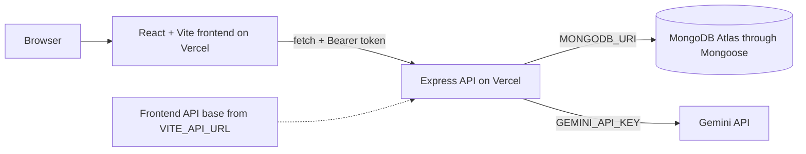

# Campus Lost & Found Tracker

A web application for the campus community to report lost and found items, browse reports, and submit claims to reunite items with their owners. Signed-in users can also use the protected AI Report Review page to improve the identifying details in an item report.

## Core entities

- **User** — a registered student or staff account.
- **Item** — a lost or found item report, including its description, location, report date, status, and owner.
- **Claim** — a signed-in user's request to claim an item, with proof of ownership.

## Technology

The frontend uses React, TypeScript, Vite, Tailwind CSS, React Router, Zustand, TanStack Query, React Hook Form, Zod, and Shadcn UI. The API is in the sibling Express, TypeScript, MongoDB, Mongoose, and JWT repository.

## Live deployments

- Frontend: [itelect4-project-pi.vercel.app](https://itelect4-project-pi.vercel.app)
- Backend: [itelect4-backend-woad.vercel.app](https://itelect4-backend-woad.vercel.app)
- Backend health endpoint: [api/health](https://itelect4-backend-woad.vercel.app/api/health)

## Local development

Use Node 24 and npm.

1. Start the backend from the itelect4-backend repository after configuring its local environment.
2. In this repository, copy the .env.example file to .env and set VITE_API_URL to http://localhost:4000.
3. Install dependencies with npm ci.
4. Start Vite with npm run dev. The frontend is available at http://localhost:5173.

The API base is read from VITE_API_URL. Set it to the backend origin only, without a trailing slash or /api suffix. The test configuration supplies a local-only value so frontend tests do not depend on .env.

## Routes

- / — dashboard
- /items — item reports
- /items/:id — item details
- /login — sign in
- /register — create an account
- /claims — protected claim workflow
- /review — protected AI item-report review

## Architecture

## Checks

- npm run lint — ESLint
- npm test — Vitest component, hook, and form validation tests
- npm run build — TypeScript check and production Vite build

## AI-use disclosure

AI tools were used as development assistants for selected code review, testing/CI guidance, and documentation tasks. The final implementation remains subject to the student's own review, testing, and explanation.
